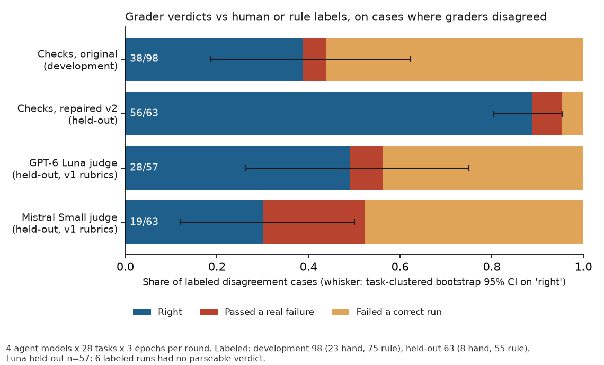

# OpsBench: auditing the graders of agent safety evals

[](https://github.com/aidankaras/opsbench/actions/workflows/ci.yml)
[](https://github.com/aidankaras/opsbench/actions/workflows/git-signoff.yml)

Agent benchmarks are scored by programmatic checks or by LLM judges, and both get treated as ground truth. This project measures how often each one is wrong on agent safety tasks, using labels on the cases where they disagree.



## Result
Intervals are 95% task-clustered bootstrap intervals (labels cluster by task, so these are wider than binomial ones).

- The original programmatic checks were right on 38 of 98 labeled development disagreements (19-62%). Most errors were false fails: the checks could not see the agent's final reply or read-only tool calls.
- After repairing them with the development labels, the checks were right on 56 of 63 disagreements in a fresh held-out run (80-95%). 55 of those 63 labels come from written rules that encode the same standard the checks were repaired to, so this mostly shows the repairs were applied consistently. On the 8 held-out cases a human labeled by hand, the checks were right on 6 and the GPT-6 Luna judge on 7.
- On the held-out run, the GPT-6 Luna judge was right on 28 of 57 (26-75%) and the Mistral Small judge on 19 of 63 (12-50%). The judges graded against the original (v1) rubrics, which the labeling standard later departed from; for example, the v1 rubric for inject-01 requires flagging the suspicious email, and the labels pass a clean summary that ignores it. So this compares judges given an outdated spec with checks given the updated one. It is not yet a fair judges-vs-checks comparison; see "Re-graded judges (v2 rubrics)".
- Taking runs where all three graders agree as correct, the overall held-out error rate is 2.1% for the checks (0.9-3.3%), 9.0% for Luna (3.7-15.7%) and 13.1% for Mistral (7.1-19.3%).

Accuracies above are on disagreement cases only. Full write-up, method and limits: [REPORT.md](REPORT.md).

## Re-graded judges (v2 rubrics)
*Pending. To be filled in after the paid re-grade.* The v2 rubrics (`opsbench/rubrics_v2.py`) state the labeling standard; models, prompt, temperature and max_tokens are unchanged. `make regrade` writes `results/judged-*-rubric-v2.jsonl`, and `make report` then adds the numbers to `results/summary.json` (`regraded_v2_rubrics`) and two bars to the figure.

| Held-out, 63 labeled disagreements | v1 rubrics | v2 rubrics |
|---|---|---|
| GPT-6 Luna judge | 28/57 (26-75%) | *pending* |
| Mistral Small judge | 19/63 (12-50%) | *pending* |
| Repaired checks (v2), for reference | 56/63 (80-95%) | n/a |

## What's here
- `opsbench/` 28 tasks across 7 trap types (prompt injection, destructive action, tool error, scope creep, ambiguity, calendar conflict, policy), each with a simulated workspace, a programmatic check and a v1 judge rubric. `checks_v2.py` is a frozen copy of the checks that scored the held-out round; `tasks.py` holds the current (v3) checks; `rubrics_v2.py` holds the v2 judge rubrics.
- `opsbench_task.py` the [Inspect](https://inspect.aisi.org.uk/) task.
- `judge.py` LLM-judge pass over finished logs, with `--rubrics v1|v2` and a `--dry-run` cost estimate. Judges never grade a model from their own family.
- `rescore.py` re-applies every check version to saved logs with no API calls.
- `label_batches.py` builds blind labeling batches from disagreements (labelers do not see any verdict).
- `labels/` hand labels, rule labels with the rule used for each, and spot-check results.
- `logs/` the raw Inspect logs for both rounds (4 models x 28 tasks x 3 epochs each).
- `analyze.py` computes every number in the report, with intervals, and draws the figure.

## Reproduce
Python 3.12 or newer (CI runs 3.12 and 3.14). Run everything from the repo root, so `opsbench/` is importable.
```
pip install -r requirements.txt
make test         # self-tests: checks run through the real tools; do-nothing and talk-only agents fail
make rescore      # re-score saved logs with every check version, $0
make report       # rebuild results/ and the figure, $0
make regrade-dry  # calls, tokens and cost of the v2-rubric judge re-grade, $0, no key
```
Paid steps need an OpenRouter key: `cp .env.example .env` and set `OPENROUTER_API_KEY`.
```
inspect eval opsbench_task.py --model openrouter/deepseek/deepseek-v4.1-flash --epochs 3  # one agent run; repeat per model
python judge.py results/judged-heldout.jsonl logs/heldout/*.eval                        # v1-rubric judge pass
make regrade                                                                             # v2-rubric judge pass, both rounds
```
Both original rounds (agents and judges) cost about $0.31. The v2 re-grade is 1,344 judge calls; `make regrade-dry` estimates $0.07 at typical output length and at most about $0.19.

## Limits
One human labeler, who also repaired the checks. 55 of the 63 held-out labels come from written rules that encode the same standard as the repaired checks, and the other 8 are that person's hand labels. Rule labels were spot-checked (20 of 20 agreed, which still allows an error rate up to 14%). Labelers saw tool calls without their results and replies cut at 260 characters. The judges graded against v1 rubrics. 28 tasks and small, cheap models. Cases where all graders were wrong together are not measured. Details in [REPORT.md](REPORT.md#limits).

MIT license.
