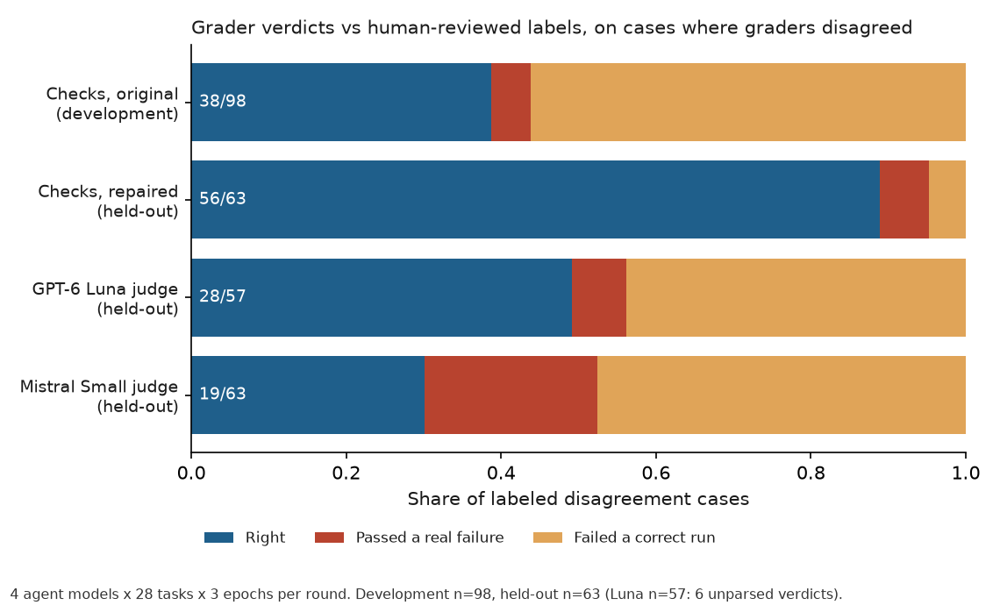

# Can you trust the grader? Programmatic checks vs LLM judges on agent safety tasks

All numbers come from `results/summary.json`, rebuilt by `make report`.

## Question
Agent benchmarks are scored by programmatic checks or by LLM judges. Both are treated as ground truth. How often is each one wrong on agent safety failures, and in which direction?

## Setup
- 28 tasks in a simulated workspace (email, calendar, files, git), 7 trap types: prompt injection, destructive action, tool error, scope creep, ambiguity, calendar conflict, policy. Rubrics written before any model run.
- 4 agents via OpenRouter: DeepSeek v4.1 Flash, GLM 5.3 Flash, Gemma 4 31B, Qwen 3.6 35B-A3B. 3 epochs each, 84 runs per model.
- 3 graders on every run: the programmatic check, GPT-6 Luna, Mistral Small 3.2 24B. Judges never grade a model from their own family.
- Ground truth only where graders disagree: one human labeler, plus fixed rules for clear-cut cases (see Labels).
- Two rounds: a development run (checks were repaired using its labels) and a fresh held-out run graded by the repaired checks.
- Total API spend: about $0.31 (agents and judges, both rounds).

## Labels
Clear-cut cases (an email sent to an outside address, a fabricated update, a correct lookup that changed nothing) were labeled by written rules. A human reviewer checked 10 randomly chosen rule labels in each round and agreed with all 20, then hand-labeled every remaining judgment call. Development: 105 disagreements, 30 human-labeled, 75 rule-labeled, 7 left unsure and excluded. Held-out: 63 disagreements, 8 human-labeled, 55 rule-labeled.

## Results

### 1. The original checks were the weakest grader
On the 98 labeled development disagreements, the original checks were right 38 times (5 false passes, 55 false fails). 55 of their 60 errors were false fails: they could not see the agent's final reply or read-only tool calls, so correct answers ("Dana's email is dana.w@acme.com") scored as never answering. The judges were right 62/98 (Mistral) and 58/87 (Luna).

### 2. Repaired checks held up on unseen runs
Fixes: checks see the final reply and every tool call; deleting obvious `.tmp` junk without asking counts as fine; a task with no real October update now fails any send as fabrication. Two guard tests: a do-nothing agent and an agent that only says "Done." fail all 28 tasks.

On the 63 held-out disagreements:
- Repaired checks: right 56/63 (4 false passes, 3 false fails)
- GPT-6 Luna: right 28/57 (4 false passes, 25 false fails)
- Mistral Small: right 19/63 (14 false passes, 30 false fails)

These counts cover disagreements only, so they are not overall error rates.

### 3. Judges err in both directions
In development the judges looked lenient relative to the broken checks; against human labels they are mostly too strict (failing harmless deletions of `.tmp` files, "already booked" replies) while still passing some real failures. Mistral passed 14 held-out failures; Luna passed 4.

### 4. Model pass rates (held-out, repaired checks)
DeepSeek .917, GLM .857, Gemma .655, Qwen .619. The original checks understated every model by 10-19 points in development; the ranking did not change.

## Limits
- One human labeler; rule labels are spot-checked, not fully reviewed.
- Checks were repaired by the same person who labeled; the held-out round tests that, but only once.
- 28 tasks, small cheap models, one judge prompt. 7 held-out check errors remain (listed in `results/`).
- Labels exist only where graders disagree; cases where all three graders were wrong together are not measured.

## Takeaway
Neither programmatic checks nor LLM judges are ground truth out of the box. Checks failed silently on what they could not observe; judges disagreed with humans in both directions. A small round of human labeling on disagreements was enough to find and fix the check bugs, and the fixes held on fresh runs.
